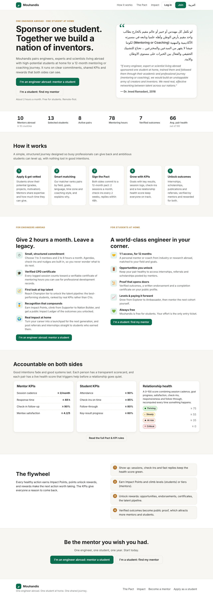
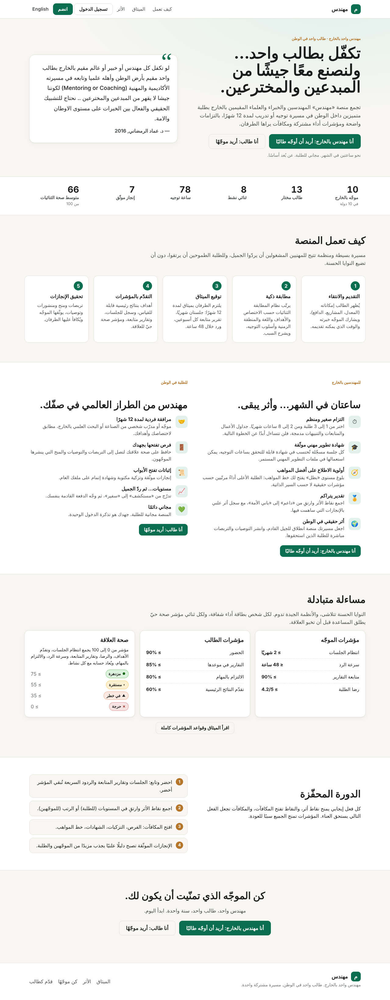
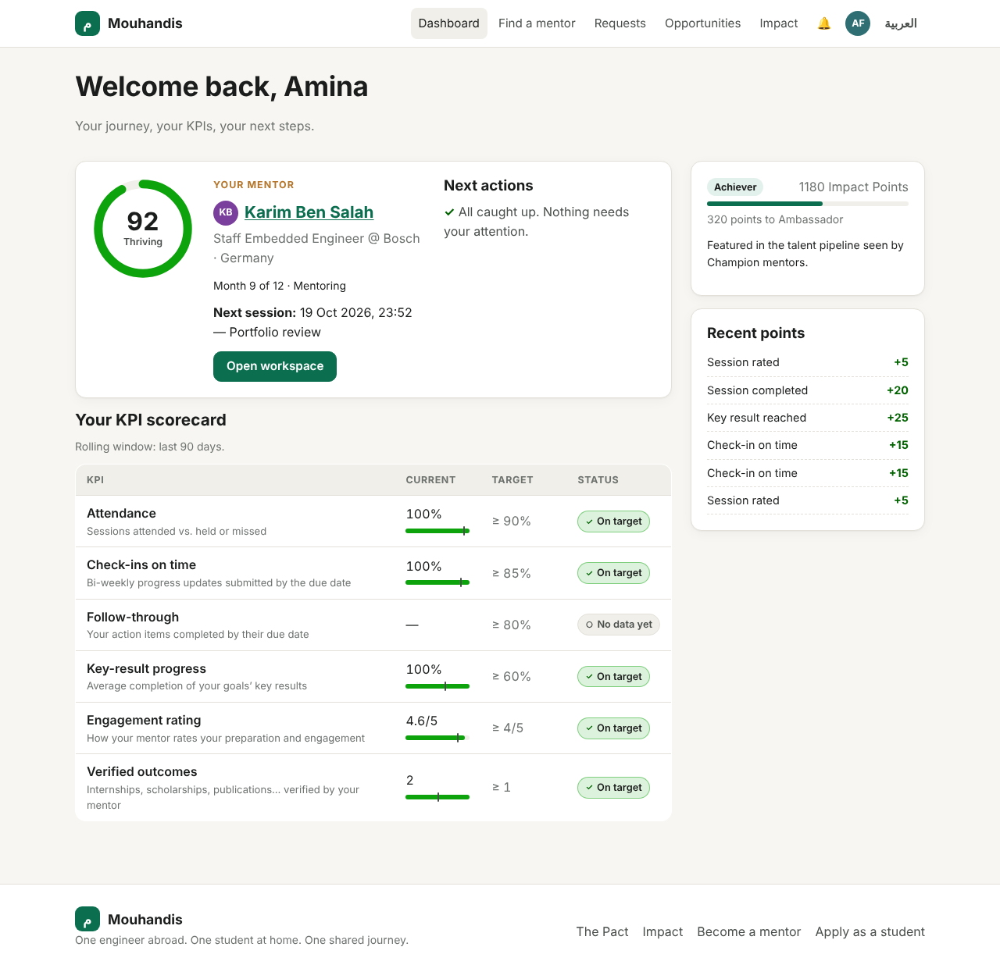
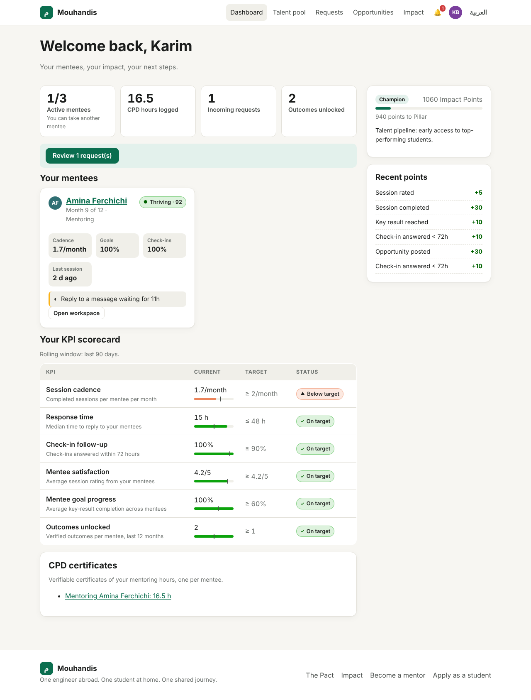
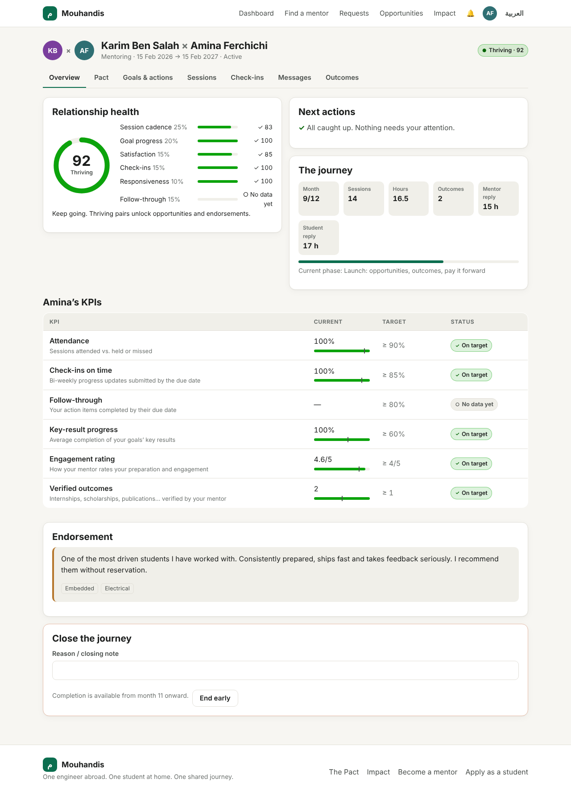
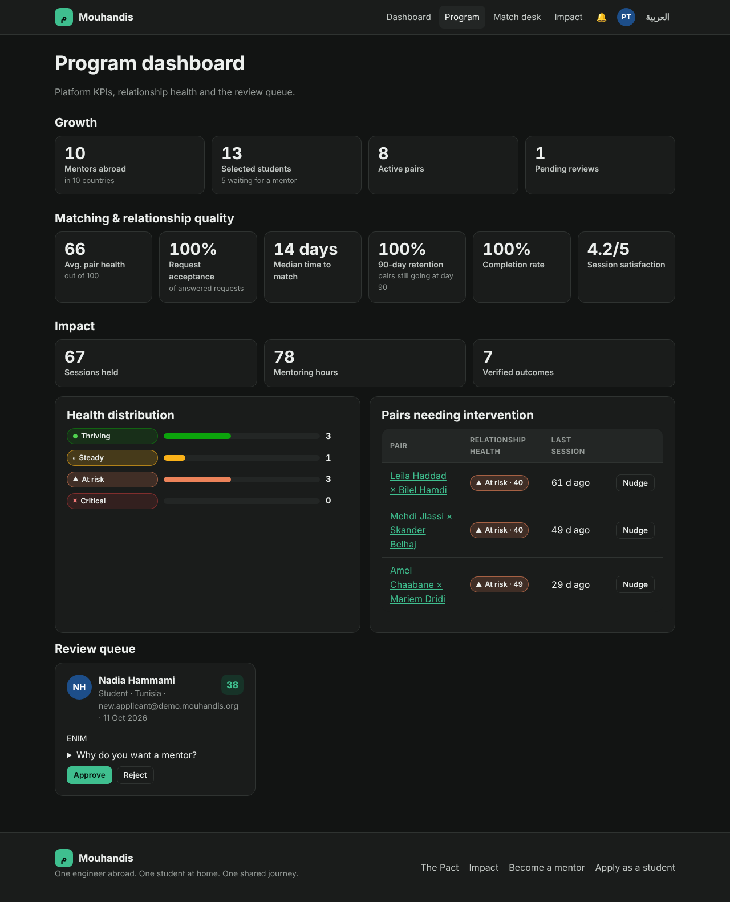

# Mouhandis · مهندس

> «لو تكفل كل مهندس أو خبير أو عالم مقيم بالخارج بطالب واحد مقيم بأرض الوطن وأهله علميا وتابعه في مسيرته الأكاديمية والمهنية (Mentoring or Coaching) لكوننا جيشا لا يقهر من المبدعين والمخترعين.» (Dr. Imed Ramadani, 2016)

Mouhandis is a platform that pairs **one engineer, expert or scientist living abroad** with **one high-potential student at home** for a structured **12-month mentoring or coaching journey**. It is **KPI-driven**: both people sign a Pact, each has a transparent scorecard, and every pair has a live **relationship health score**. Keeping these KPIs green unlocks rewards on both sides.

## Quick start

Requires **Node.js ≥ 22.13**. There are no npm dependencies; the app uses the built-in `node:sqlite`.

```bash
npm run seed     # creates data/mouhandis.db with fictional demo data
npm start        # http://localhost:3000
npm test         # unit + end-to-end tests (EN and AR)
```

Demo accounts (password `mouhandis2026`):

| Role | Email |
|---|---|
| Student (thriving pair) | `amina.student@demo.mouhandis.org` |
| Mentor (Champion tier, incoming request) | `karim.mentor@demo.mouhandis.org` |
| Mentor (at-risk pair) | `amel.mentor@demo.mouhandis.org` |
| Student (waiting for a mentor) | `rania.student@demo.mouhandis.org` |
| Program admin | `admin@demo.mouhandis.org` |

All demo people and companies are fictional placeholders.

### Configuration

| Env var | Default | Meaning |
|---|---|---|
| `PORT` | `3000` | HTTP port |
| `DB_PATH` | `data/mouhandis.db` | SQLite file |
| `APP_SECRET` | dev value | HMAC key for verifiable certificate codes. **Set this in production.** |
| `AUTO_APPROVE` | on | Set to `0` to require admin verification for mentors |
| `NODE_ENV` | | `production` adds `Secure` to cookies |

## What's inside

- **Landing page** (`/`): the founding quote, live impact numbers, how it works, incentives for each side, KPIs and the flywheel.
- **The Pact** (`/pact`): commitments, KPI targets, health-score formula, points, tiers and levels, and the rewards each one unlocks. Everything is generated from `src/config.js`, so the rules and the code can't drift apart.
- **Onboarding with screening**: students get a *potential score* (grades, evidence, motivation, skills). Scores of 65 or more are auto-approved; the rest go to the admin review queue.
- **Explainable matching** (`/discover`): ranks by field 40, aspirations 20, language 15, mode 10, time zone 10 and availability 5, and shows the reasons. Students send up to 3 requests and mentors can offer to sponsor. Requests expire after 7 days.
- **Pair workspace** (`/m/:id`): the Pact signature, goals with key results, action items, sessions (schedule, log, two-way rating), bi-weekly check-ins with mentor replies, messages, outcomes with mentor verification, endorsement and closing.
- **Nudges**: a prioritised "next actions" list for each side, driven by the same signals as the KPIs.
- **Opportunities board**: mentors post internships, referrals and scholarships. Students can apply only while their pair health is at least 55 and their level is high enough.
- **Gamification**: idempotent Impact Points ledger, student levels (Explorer to Ambassador), mentor tiers (Supporter to Nation Builder), leaderboard and public profiles with an Impact Ledger.
- **Certificates**: verifiable mentor CPD-hours certificates and student completion certificates (`/certificate/...`, HMAC-coded).
- **Program dashboard** (`/admin`): growth, match quality, 90-day retention, completion, health distribution, the at-risk list with one-click nudges, the review queue and a match desk.
- **Bilingual**: English and Arabic with a full RTL layout. Light and dark themes, works on mobile.

See [`docs/PRODUCT.md`](docs/PRODUCT.md) for the product rationale: incentive design, KPI definitions and the reasoning behind each choice.

## Architecture

```
server.js               entry point
src/config.js           Pact, KPI targets, health weights, points, tiers, gates
src/db.js               SQLite schema (node:sqlite)
src/app.js, http.js     tiny router, cookies, CSRF, security headers
src/auth.js             scrypt passwords, server-side sessions
src/services/kpi.js     pair KPIs, health score, scorecards, platform KPIs
src/services/matching.js, potential.js, points.js, nudges.js, pairs.js
src/routes/*.js         public, onboarding, dashboard, matching, mentorship, opportunities, admin
src/views/*.js          escaped HTML templates + components (ring gauge, meters, scorecards)
src/i18n/{en,ar}.js     dictionaries
scripts/seed.js         deterministic demo data
test/                   unit tests + end-to-end journey + bilingual crawl
```

Security: every interpolation is HTML-escaped by default, CSRF tokens are checked on all POSTs, cookies are `HttpOnly` and `SameSite=Lax`, there is a strict CSP with no inline scripts, and passwords are hashed with scrypt.

## Screenshots

| Landing | Arabic (RTL) |
|---|---|
|  |  |
| **Student dashboard** | **Mentor dashboard** |
|  |  |
| **Pair workspace** | **Program dashboard (dark)** |
|  |  |
